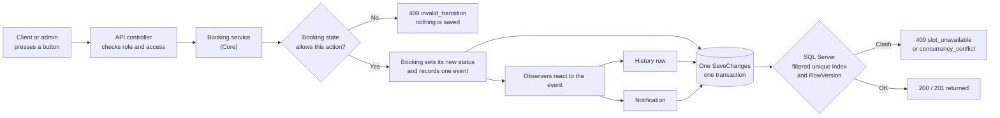

# State and Observer: the design choices in plain language

One-page explanation of why the booking engine is built the way it is. The detailed class diagrams and
sequence diagrams are in [architecture.md](architecture.md); the rules themselves are in
[CONTRACTS.md](CONTRACTS.md) section 3. Owner: Daniel (P2).

## The idea in two sentences

A booking has four statuses, and **the State pattern** decides which actions each status allows and where
each action leads. Every time the status changes, the booking only *records what happened*, and **the
Observer pattern** lets separate observers write the history row and the notifications.

## One change, from click to database

## Why each choice was made

| Choice | Why | What it costs (the trade-off) |
|---|---|---|
| **Statuses and their rules live in Core**, not in the controllers, the web app or the database | The rules are the business. In Core they can be tested with no web server and no database (`BookingStateTests`, `BookingTransitionMatrixTests`), and the web app cannot bypass them because it only talks to the API. The layer rules are checked by an architecture test in CI | More classes (one per status) than a single `switch`. Worth it: each status's full rule set is readable in one file, and a status that forgets a case refuses the action by default instead of allowing it |
| **Observers record history and notifications**, not the booking or the controller | The booking stays small and only says "I changed from X to Y". Adding email later means adding one observer, not editing five actions. History and notification can never be forgotten for a new action | The reaction is not visible where the status changes, so you must know the observers exist. They add rows to the same save, so the change, its history and its notifications are stored together or not at all |
| **A SQL filtered unique index guards the slot**, not only the booking screen or the service code | Two clients can pass the "is the slot free?" check at the same instant. Only the database can make a second active booking impossible. The index covers only `Requested` and `Confirmed`, so a cancelled booking frees the slot automatically | The loser of a race gets a `409` instead of a friendly pre-check. The code still checks first, so the normal case gets a clear message and the index catches the rare race |
| **RowVersion on every change** | A stale screen can't overwrite someone else's work: the change is refused with `409 concurrency_conflict` | The client must send the version it last saw, and a refused user has to reload |
| **A rejected booking becomes `Cancelled`**, with the reason `"Rejected: ..."`, not a fifth status | Fewer statuses means fewer transitions to get wrong, one list everywhere, and the state diagram stays small. A rejection and a cancellation both end the booking and free the slot, so they behave the same | The two outcomes share a status; the reason prefix (and the `BookingRejected` notification) tells them apart. A report that counts rejections must filter on the prefix |

## Alternatives we rejected

- **`if (status == ...)` in every service method.** Rules get copied and drift apart. A new status means
  hunting through every method.
- **Services writing history and notifications directly.** Easy to forget in one action, and email would
  mean editing every action.
- **A "Pending/Rejected/Rescheduled" status set.** Rescheduling is an action, not a state: a confirmed
  booking that moves simply goes back to `Requested` for re-approval.
- **Locking the slot in code only (or relying on the UI to grey it out).** Cannot stop two simultaneous
  requests; the browser is not a safe place for a business rule.

## Tested scenario: two clients press "Book" for the same slot

1. Both requests reach the API at the same moment and both pass the "is it free?" check.
2. Each tries to save; SQL Server's `UX_Bookings_ActiveSlot` lets exactly one insert through.
3. The winner gets `201 Created` with a reference. The loser gets `409 slot_unavailable` and nothing was
   half-saved: the booking, its history row and its notification are in one transaction.
4. If the winner is later rejected or cancels, the slot is free again and the next client can book it.

**Where it is proved** (real API, real SQL Server):

| Test | What it shows |
|---|---|
| `ConcurrentBookingTests.PostBookings_TwentyClientsSameSlot_ExactlyOneSucceeds` | 20 clients, one slot: one 201, nineteen 409, one active booking in the database |
| `BookingTransitionEvidenceTests.PostBookings_TwoUsersSameSlot_OneCreatedOneConflict` | The two-user version of the same race |
| `BookingTransitionEvidenceTests.CancelAndConfirm_SameRowVersion_ExactlyOneWinsAndHistoryAgrees` | A cancel and a confirm at the same moment: one wins, and the stored status and history agree |
| `BookingLifecycleApiTests.Lifecycle_Reject_CancelsNotifiesAndFreesSlot` | A rejection ends as `Cancelled`, the client is told why, and the slot can be booked again |

## Questions you may be asked

**Why not just one big `switch` on the status?**
It works at first, but the same rules end up in many methods. With one class per status, the rules for
"Confirmed" are in one place, and an action nobody wrote is refused automatically.

**Where is the Observer pattern, exactly?**
`IBookingObserver` with two observers: `StatusHistoryObserver` and `NotificationObserver`. The booking records
`BookingStatusChanged` events; `BookingEventDispatcher` hands each event to every observer just before the save.

**What if the notification fails? Is the booking still changed?**
No. Observers only add rows to the same unit of work, so the booking change, history and notifications are
saved in one transaction. All three are stored or none are.

**The page already stops you picking a taken slot. Why the database index too?**
The page can be out of date by the time you press the button, and two people can press at once. A check in
code or in the browser can be raced; a unique index in the database cannot.

**Why is a rejected booking "Cancelled"?**
Both end the booking and free the slot, so they need the same behaviour. A separate status would double the
transitions to maintain. The `Rejected: ` reason and the `BookingRejected` notification keep them distinguishable.

**Can a booking go backwards?**
Only one way: a `Confirmed` booking that is rescheduled returns to `Requested`, because an admin must check
the assigned staff member is free at the new time. `Completed` and `Cancelled` are final.

**What stops a client completing their own booking?**
Two layers: the API only lets the assigned staff member or an admin call the complete endpoint (403 or 404
otherwise), and the `Requested` state refuses `Complete` anyway. `Confirmed` also refuses it before the slot starts.

**How do you know it is not just working on your machine?**
The same tests run in CI against SQL Server 2022 in a container on every pull request.
