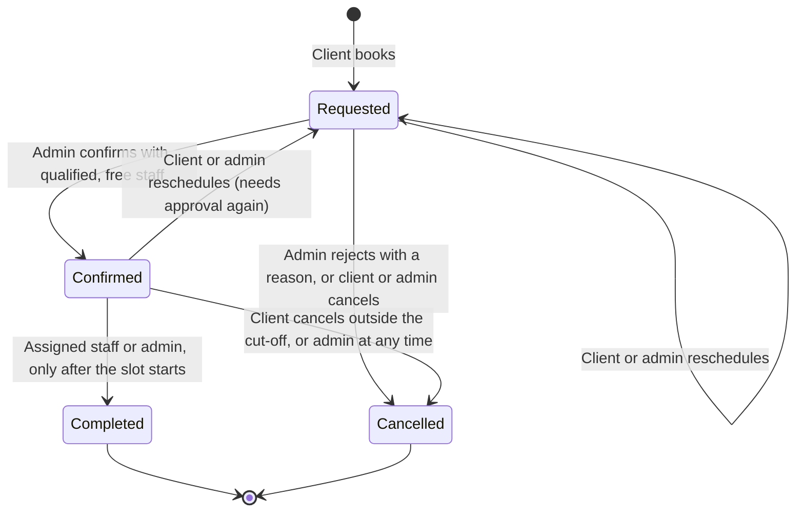
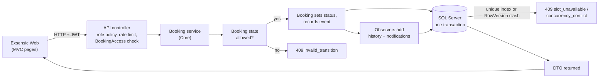

# Chapter 5: Booking logic and API

Owner: Daniel (P2). This chapter covers the booking lifecycle, the State and Observer design, the data flow, the API route inventory, errors and their interaction with security, concurrency and performance, and the test evidence. It describes what is in the repository on `develop`; anything partial or unmeasured is marked as such.

Related: [architecture.md](../architecture.md) (class and sequence diagrams), [state-observer-tradeoffs.md](../state-observer-tradeoffs.md) (the design choices in plain language), [CONTRACTS.md](../CONTRACTS.md), [openapi.md](../openapi.md), [security.md](../security.md), [user-guide-staff.md](user-guide-staff.md).

## 5.1 The booking lifecycle

A booking has four statuses. The rules are in `docs/CONTRACTS.md` section 3 and are enforced only by the State classes in `Exsensic.Core`.

- **A rejection is `Cancelled`**, with a reason that starts `"Rejected: "`. There is no fifth status (CONTRACTS section 12, decision 2).
- **Rescheduling is an action, not a status.** A confirmed booking that moves returns to `Requested`, because an admin must check the staff member is free at the new time.
- **Cancellation cut-off:** a client can't cancel a confirmed booking within `BookingPolicy:ClientCancelCutoffHours` (default 24) of its start (`409 cancel_window_closed`). An admin can cancel at any time.
- **A slot is held only by `Requested` and `Confirmed` bookings.** Cancelling, rejecting or completing frees it.

### Lifecycle evidence

Every row was run through the real API against a real SQL Server database. The clock is moved forward with a test clock, so time rules run without waiting.

| # | Scenario | API result | Database state | Test |
|---|---|---|---|---|
| 1 | Client books a free slot | `201` + `Location`, status `Requested` | 1 history row (none → Requested); client notified `BookingRequested` | `BookingLifecycleApiTests.Lifecycle_CreateConfirmComplete_...`, `BookingCreationTests` |
| 2 | Admin confirms with a qualified, free staff member | `200`, `Confirmed`, staff named | History gains Requested → Confirmed; client gets `BookingConfirmed`, staff gets `StaffAssigned` | same lifecycle test; `AdminBookingApiTests.Confirm_QualifiedFreeStaff_...` |
| 3 | Staff completes before the slot starts | `409 invalid_transition` | Unchanged | lifecycle test; `StaffBookingApiTests.Complete_BeforeSlotStart_...` |
| 4 | Staff completes after the slot starts | `200`, `Completed` | History gains Confirmed → Completed; client gets `BookingCompleted` | lifecycle test |
| 5 | Admin rejects with a reason | `200`, `Cancelled`, reason `Rejected: ...` | Client gets `BookingRejected`; the slot can be booked again | `BookingLifecycleApiTests.Lifecycle_Reject_...` |
| 6 | Client reschedules a confirmed booking | `200`, back to `Requested`, staff kept | History gains Confirmed → Requested; staff gets `BookingRescheduled`; the client gets no notice of their own action | `BookingTransitionEvidenceTests.Reschedule_ConfirmedByClient_...` |
| 7 | Admin reschedules a confirmed booking | `200`, `Requested` | Client gets `BookingRescheduled` | `...Reschedule_ConfirmedByAdmin_...` |
| 8 | Client cancels inside the cut-off | `409 cancel_window_closed` | Unchanged | `BookingLifecycleApiTests.Lifecycle_CancelAsStartApproaches_...` |
| 9 | Admin cancels inside the cut-off | `200`, `Cancelled` | Client and staff notified `BookingCancelled` | `...Cancel_ConfirmedByAdmin_...` |
| 10 | Two users book the same slot at once | one `201`, one `409 slot_unavailable` | Exactly one active booking for the slot | `ConcurrentBookingTests` (20 users), `...PostBookings_TwoUsersSameSlot_...` |
| 11 | Two bookings are moved into the same slot at once | one `200`, one `409 slot_unavailable` | One active booking holds the slot | `...Reschedule_TwoBookingsIntoSameSlot_...` |
| 12 | Stale `RowVersion` on confirm, complete, reschedule, cancel or reject | `409 concurrency_conflict` | Unchanged | `AdminBookingApiTests`, `StaffBookingApiTests`, `BookingChangeApiTests`, `...Cancel_StaleRowVersion_...`, `...Reject_StaleRowVersion_...` |
| 13 | A cancel and a confirm race with the same `RowVersion` (5 repeats) | one `200`, one `409` | Stored status and history agree with the winner | `...CancelAndConfirm_SameRowVersion_...` |

Rows 1 to 13 prove the API and the database. What the Web pages show for the same journey was checked separately and is in section 5.10.

## 5.2 State and Observer design

- **State pattern.** `BookingState` has one subclass per status (`RequestedState`, `ConfirmedState`, `CompletedState`, `CancelledState`). Each action throws `InvalidBookingTransitionException` by default, so a status allows only what it explicitly overrides. The states only answer "what is the next status?"; `Booking.Behaviour.cs` applies the answer and records one `BookingStatusChanged` event.
- **Observer pattern.** `BookingEventDispatcher` hands each recorded event to every `IBookingObserver`. `StatusHistoryObserver` writes the timeline row and `NotificationObserver` writes the in-app notifications. Observers only add rows; the booking change, its history and its notifications are saved together in one transaction.
- **Why in Core:** the rules can be tested without a web server or database, and the Web project can't bypass them because it only talks to the API (architecture test in CI).

The reasoning and the rejected alternatives are in [state-observer-tradeoffs.md](../state-observer-tradeoffs.md). The class diagrams are in [architecture.md](../architecture.md) sections 2 and 3.

## 5.3 Data flow

Controllers are thin: they check the caller's role and access, pass the request and user id to a service, and map the result. Business rules live in `Exsensic.Core/Bookings`. Errors are thrown as exceptions by the services and turned into ProblemDetails in one place (`ProblemDetailsExceptionHandler`).

## 5.4 API route inventory

The API has 34 operations under `/api/v1`, plus `/health` and `/health/ready`. The complete, machine-readable list is [openapi.json](../openapi.json), generated from the real controllers and checked by tests on every change (see [openapi.md](../openapi.md)). The 15 operations owned by P2:

| Route | Who | Success | Notable failures |
|---|---|---|---|
| `POST /bookings` | Client (rate limited: 10 per 10 min per user) | `201` + `Location` | `400` bad requirements, `409 slot_unavailable`, `429` |
| `GET /bookings/mine?status=&page=&pageSize=` | Client | `200` paged | `400` unknown status |
| `GET /bookings/{id}` | Owner client, assigned staff, admin | `200` | `404` for anyone else |
| `PUT /bookings/{id}/reschedule` | Owner client, admin | `200` | `403` staff, `404` stranger, `409` taken slot / stale / final |
| `PUT /bookings/{id}/cancel` | Owner client, admin | `200` | `409 cancel_window_closed`, `409 invalid_transition`, `409 concurrency_conflict` |
| `GET /admin/dashboard` | Admin | `200` | `403` |
| `GET /admin/bookings?status=&from=&to=&page=` | Admin | `200` paged | `400` bad date range |
| `GET /admin/staff?serviceId=&timeSlotId=` | Admin | `200` qualified, free staff | `400` / `404` unknown ids |
| `PUT /admin/bookings/{id}/confirm` | Admin | `200` | `409 staff_unavailable`, `invalid_transition`, `concurrency_conflict` |
| `PUT /admin/bookings/{id}/reject` | Admin | `200` | `400` empty reason, `409` |
| `GET /staff/me/bookings?from=&to=` | Staff | `200` list | `400` bad range (max 62 days) |
| `PUT /staff/bookings/{id}/complete` | Assigned staff, admin | `200` | `409 invalid_transition` before the start, `404` other staff |
| `GET /notifications/mine` | Signed in | `200` list | `401` |
| `PUT /notifications/{id}/read` | Signed in | `204` | `404` not yours |
| `GET /services/{serviceId}/requirement-template` | Anonymous | `200` | `404` |

The other 19 operations (sign-in, profile, catalogue, time slots and users) belong to P3.

## 5.5 Errors and their interaction with security

Every error is RFC 9457 ProblemDetails with a `code` and a `traceId` (CONTRACTS section 7). Never a stack trace; unexpected faults are a generic `500 server_error` with the details only in the logs.

| Status | Code | When |
|---|---|---|
| 400 | `validation_failed` | Bad input; per-field errors. Also used for other client errors the framework raises: `405`, `406`, `413`, `415` |
| 401 | `unauthenticated` | No or invalid token |
| 403 | `forbidden` | Signed in with the wrong role |
| 404 | `not_found` | Missing, **or a booking that isn't yours** |
| 409 | `slot_unavailable`, `invalid_transition`, `concurrency_conflict`, `staff_unavailable`, `slot_has_booking`, `duplicate`, `cancel_window_closed` | Business rules and races |
| 429 | `rate_limited` | Too many requests; `Retry-After` set |
| 500 | `server_error` | Unexpected |

How errors and security work together:

- **404 for someone else's booking, 403 for the wrong role** (CONTRACTS decision 10). A client probing booking ids can't tell a missing booking from another client's, which defeats insecure direct object reference (IDOR) guessing.
- **Authorisation runs before validation.** A wrong role gets `403` before the body or id is looked at, so an attacker learns nothing from validation messages. The fallback policy requires sign-in, so an unauthenticated caller gets `401` even on an unknown route.
- **Rate limits** protect the expensive or abusable routes: sign-in 5 per minute per IP, registration 3 per minute per IP, booking creation 10 per 10 minutes per user. The `429` is ProblemDetails with `Retry-After`.
- **No personal data in notifications or logs.** Notification text holds the reference, service and time only; requirement text, emails and passwords are never logged.
- **The API description is not a map of production.** `openapi.json` is a committed file; no deployed API serves it (a signed-in admin and an anonymous caller both fail to reach `/openapi/v1.json` outside Development), and it holds no secrets or server addresses.

## 5.6 Concurrency and performance

Three layers stop two people from corrupting a booking, from friendliest to strongest:

1. **Code checks** (slot free, not blocked, long enough) give a clear message in the normal case.
2. **Optimistic concurrency.** Every change sends the `RowVersion` the user last saw. A mismatch is refused with `409 concurrency_conflict`; a change that slips in between the check and the save is caught by EF Core's own `RowVersion` check.
3. **The filtered unique index `UX_Bookings_ActiveSlot`** on `Bookings.TimeSlotId` where `Status IN ('Requested','Confirmed')`. This is what makes a second active booking for a slot impossible even when two requests pass the code check at the same instant.

Each change runs in one transaction (retried as a whole after a brief connection drop), so the booking, its history and its notifications are stored together or not at all.

**Performance measures in the code:**

- Reads use `AsNoTracking()` and project straight to DTOs.
- Lists are paged: default 20, maximum 100. Staff and admin date ranges are capped at 62 days, and availability at 60 days.
- Indexes support the common queries: bookings by client and status, by staff and status, by status and creation date; slots by date and blocked flag; notifications by user and read state (CONTRACTS section 4, chapter 6).
- A schedule row's requirement summary is shortened to 120 characters.

**Not measured:** there is no load test or benchmark. The only measured concurrency evidence is the correctness tests above (20 simultaneous bookings for one slot gave one winner). Claims about capacity or response time would need a load test that was not done.

## 5.7 Test evidence

Run on `develop` after all the P2 pull requests below were merged: `dotnet build Exsensic.sln -c Release` gave 0 warnings and 0 errors; unit tests **110 passed**; integration tests **303 passed**; none failed or were skipped. CI runs the same suites against SQL Server 2022 in a container on every pull request.

| Area | Where | Cases |
|---|---|---|
| State rules and the full transition matrix | `BookingTransitionMatrixTests`, `BookingStateTests` (unit) | 33 + 27 |
| Observers (history, notifications) | `BookingObserverTests` (unit) | 10 |
| Requirement validation | `RequirementValidatorTests` (unit) | 28 |
| Layer rules | `ProjectReferenceTests` (unit) | 7 |
| Booking journeys, reschedule and cancel | `BookingLifecycleApiTests`, `BookingChangeApiTests` | 3 + 10 |
| Admin and staff booking actions | `AdminBookingApiTests`, `StaffBookingApiTests`, `AdminOverviewApiTests` | 11 + 9 + 7 |
| Races and transition evidence | `ConcurrentBookingTests`, `BookingTransitionEvidenceTests` | 2 + 10 |
| Contract: roles, errors, `Location`, `429` | `ContractConsistencyTests` | 91 |
| Error handling | `ProblemDetailsExceptionHandlerTests` | 11 |
| OpenAPI matches the routes, auth rules and documented errors | `OpenApiSpecTests` | 15 |
| Rules a coverage run showed were untested (requirement template route, staff list edges, empty staff id) | `BookingRuleGapTests` | 9 |
| Re-approving a rescheduled booking, no double assignment | `RescheduleReapprovalTests` | 3 |

The table lists the runner's per-class counts, which are not meant to add up to the totals above.

## 5.8 Technical improvements made

These changes were made during the improvement phase:

- **#67 Published API description** (`feat(api)`): the OpenAPI spec is generated from the real controllers with a bearer scheme and per-operation access, committed as `docs/openapi.json`, and checked by 8 tests that it matches the real routes and auth rules and contains no secrets. No spec endpoint is served outside Development (decision record in [openapi.md](../openapi.md)).
- **#68 Lifecycle and race proof** (`test(booking)`): 10 new tests for history and notifications on reschedule and cancel, stale `RowVersion` on cancel and reject, and races on create, reschedule, confirm and confirm-versus-cancel. They found no bug in the booking engine.
- **#69 Contract fix** (`fix(contract)`): the framework's `405` and `415` responses carried the code `server_error`, which the contract reserves for 500. They now use `validation_failed`. A 91-case sweep checks 401, 403, 404, 400, 405, 415, 201 and 429 across every route.

- **#74 Error responses in the API description** (`feat(api)`): `openapi.json` now lists 401, 403, 400, 404, 409 and 429 on each operation, using a shared problem schema with `code` and `traceId`, and only where the operation can return them. Six more tests check this, including calls to the real API.
- **Fix: empty staff id on confirm** (`fix(booking)`): a coverage run showed the requirement-template route had no test at all. Writing tests for the untested rules found a real bug: confirming a booking with an empty staff id returned **500 `server_error`**, because the booking's own guard threw an unhandled exception. It is now `400 validation_failed` naming the field, and the booking stays Requested. Nine tests cover this and the other untested rules.
- **Fix: re-approving a rescheduled booking** (`fix(booking)`): found while checking the journey in the Web pages (5.10). A confirmed booking that is rescheduled goes back to Requested and keeps its staff member as a proposal, but the staff list treated that proposal as the person being busy. With one qualified staff member the admin was told "No available staff were returned" and could not re-approve from the page. Only a Confirmed booking now makes a staff member busy; double assignment is still refused. Three tests cover it.

Documentation added: [state-observer-tradeoffs.md](../state-observer-tradeoffs.md) and [user-guide-staff.md](user-guide-staff.md).

## 5.9 Known gaps

- **The Web pages were checked by script, not in a browser** (5.10): no JavaScript, visual or accessibility checking, and no screenshots. The browser tests in `cd-staging` run only when `E2E_ENABLED` is on and cover fewer flows (client books and admin confirms, staff completes).
- **No load or performance testing** (5.6).
- **Notifications are in-app only.** Email is a stretch goal (CONTRACTS decision 11), and old notifications are never deleted.
- **`pageSize=0` returns one item per page**, not the default 20. The contract doesn't say what happens below 1, so this was left as is.
- **Rejections share the `Cancelled` status.** A report that counts rejections must filter on the `"Rejected: "` prefix.
- **Staff booking contact details** (name, email, phone) are visible to the assigned staff member by design; there is no automatic expiry of that access after completion.

## 5.10 What the Web pages showed

**Method (31 October 2026).** The API and the Web app were run on a development machine with a throwaway database and test-only accounts (not staging or production). The server-rendered pages were then driven by a script that behaves like a browser without JavaScript: it keeps the sign-in cookie, reads each page's antiforgery token, submits the real forms and reads the text the page returns. So the real controllers, views and API all took part, and every result below is what the page displayed after reloading stored data.

**Not a real browser.** The built-in browser would not load the local site because its certificate is self-signed, and trusting a certificate is a security setting that was not changed. So there are no screenshots, and nothing here tests JavaScript, layout or accessibility. The end-to-end tests in `cd-staging` are separate (5.9). The same scenario can be repeated by hand using the staff guide and the run sheet.

| # | Step | What the page showed |
|---|---|---|
| 1 | Admin dashboard on the sample data | Requested 2, Confirmed 3, Completed 1, Cancelled 1, matching the stored bookings |
| 2 | Admin opens a Requested booking | Requirements, client contact and a staff list with only the qualified, free person |
| 3 | Admin confirms with no staff chosen | Page shown again with "Please choose a staff member."; booking still Requested; no server error |
| 4 | Admin confirms with the offered person | Status Confirmed, staff named, a history row added |
| 5 | Admin rejects with no reason, then with a reason | First refused with a message; then Cancelled with the reason shown |
| 6 | The two clients open their bookings | Client A: Confirmed plus a "confirmed" notification. Client B: Cancelled, the reason, and a notification giving the reason |
| 7 | Client B opens Client A's booking address | "Not found" page (404), not the booking |
| 8 | Staff schedule | The started booking this week and the confirmed one next week; the future booking has no "Mark as completed"; another staff member's booking gives "Not found" |
| 9 | Staff completes the started booking | "The booking has been marked as completed"; Completed; history row; the client's notification says it is complete |
| 10 | Staff submits the same completion again from the old page | "Someone else changed this record..." and a "Review the latest booking" page; nothing changed |
| 11 | Client reschedules a Confirmed booking | Back to Requested; the history shows the move; the assigned staff member is notified |
| 12 | Client submits a second reschedule from the old page | "This page is out of date. Reload and review the latest booking..." |
| 13 | Client cancels a Confirmed booking more than 24 hours away | Cancelled with the reason; the assigned staff member is notified |
| 14 | Cut-off: a slot for tomorrow was created on the admin Time Slots page, booked, and confirmed; the client then tried to cancel | "The cancellation deadline has passed. Please contact the team for help."; still Confirmed. The clock was not changed |
| 15 | Two clients choose the same slot in the booking wizard | The first reaches the confirmation page; the second gets "That time is no longer available. Please choose another time." and no booking is made |
| 16 | A client opens the admin or staff pages; a staff member opens the admin pages | "Access denied" (403) |
| 17 | A sixth sign-in within a minute | "Please wait at least 60 seconds before trying again." |
| 18 | Admin opens the booking rescheduled in step 11 | **Defect found:** "No available staff were returned" although the staff member was free. After the fix the person is offered, the admin re-approves from the page, and the history shows Requested, Confirmed, Requested (moved) and Confirmed |

Steps 1 to 17 passed on the first run. Step 18 is the defect described in 5.8, found by this check and fixed with tests.
