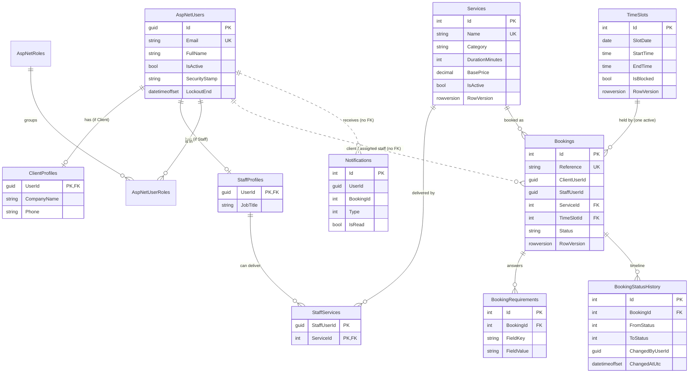

# Chapter 6: Data, security and architecture

Owner: Dean Sibley (P3). This chapter covers the database, migrations, seed data, security, admin scope and the trade-offs behind them. It describes what is in the repository on `develop`; anything partial is marked as such.

Related: [architecture.md](../architecture.md) (layers and patterns), [security.md](../security.md) (controls in detail), [migrations.md](../migrations.md), [CONTRACTS.md](../CONTRACTS.md), [operations.md](../operations.md).

## 6.1 Entity relationship diagram

Dotted lines are logical links with **no foreign key**: `Bookings.ClientUserId`, `Bookings.StaffUserId`, `Notifications.UserId` and `BookingStatusHistory.ChangedByUserId` are user ids checked by the application, not by the database. This keeps Core free of the Identity types (Core can't reference `ApplicationUser`, which lives in Data), and users are never deleted, only deactivated. The cost is that the database alone would accept an id that matches no user (see 6.9).

## 6.2 Data dictionary

| Table | Key | Constraints | Indexes | RowVersion |
|---|---|---|---|---|
| `AspNetUsers` (Identity + `FullName`, `IsActive`, `CreatedAtUtc`) | `Id` (guid) | Unique email (Identity option) | Identity defaults (normalised email, user name) | Identity `ConcurrencyStamp` |
| `ClientProfiles` | `UserId` | FK to `AspNetUsers`, restrict delete; `CompanyName` ≤ 150, `Phone` ≤ 20 | PK | No |
| `StaffProfiles` | `UserId` | FK to `AspNetUsers`, restrict delete; `JobTitle` ≤ 100 | PK | No |
| `StaffServices` | (`StaffUserId`, `ServiceId`) | FK to `Services`, restrict delete | PK, `ServiceId` | No |
| `Services` | `Id` | `Name` ≤ 120 unique; `Description` ≤ 2000; `CK_Service_Duration` 15–480 minutes; `Category` stored as string; `BasePrice` decimal(10,2) | `Name` unique | Yes |
| `TimeSlots` | `Id` | `CK_TimeSlot_EndAfterStart`; `BlockReason` ≤ 500 | (`SlotDate`, `StartTime`) unique | Yes |
| `Bookings` | `Id` | `Reference` ≤ 20 unique; `Status` stored as string with `CK_Booking_Status`; restrict delete to `Services` and `TimeSlots`; `CancellationReason` ≤ 500 | `UX_Bookings_ActiveSlot` (`TimeSlotId` unique where status is Requested or Confirmed); (`ClientUserId`, `Status`); (`StaffUserId`, `Status`); (`Status`, `CreatedAtUtc`) | Yes |
| `BookingRequirements` | `Id` | FK to `Bookings`, cascade; `FieldKey` ≤ 50 | (`BookingId`, `FieldKey`) unique | No |
| `BookingStatusHistory` | `Id` | FK to `Bookings`, cascade | (`BookingId`, `ChangedAtUtc`) | No (append-only) |
| `Notifications` | `Id` | None beyond required fields | (`UserId`, `IsRead`) | No |

The last three rows come from the `AddBookingRelatedConstraintsAndIndexes` migration (6.3). Before it, those tables had only the default `BookingId` foreign key index, and `FieldKey` was `nvarchar(max)`.

## 6.3 Migration strategy

- **Baseline.** `20261002163643_InitialCreate` created the first schema and is applied in staging and production. It is never split, renamed or edited, because each database records its id in `__EFMigrationsHistory` (full reasoning in [migrations.md](../migrations.md)).
- **Incremental changes.** Every later change is its own migration. The first is `AddBookingRelatedConstraintsAndIndexes` (Task 3): the unique (`BookingId`, `FieldKey`) index, the history and notification read indexes, and a bounded `FieldKey` (SQL Server can't index `nvarchar(max)`). Its generated SQL was reviewed with `dotnet ef migrations script --idempotent`; narrowing `FieldKey` to 50 characters can't lose data because keys come from the category templates and the longest is 14 characters.
- **No destructive recreation.** No migration drops and recreates a table with data. Indexes are dropped and replaced, columns are altered in place.
- **How it reaches Azure.** The API applies pending migrations on start-up (`Database:MigrateOnStartup`). CI applies every migration to a fresh SQL Server database in the integration tests first.
- **Rollback.** Fix forward with a new migration. Each migration has a `Down` method for local use, but production is restored, if needed, from Azure SQL's 7-day point-in-time backup rather than by running `Down` (operations.md section 4).

## 6.4 Seed strategy

`DatabaseInitialiser.InitialiseAsync` runs at start-up and is idempotent: everything is checked by a natural key before it is inserted, so restarts never duplicate rows.

| Seeded | Always or demo only | Idempotency key |
|---|---|---|
| Roles Client, Staff, Admin | Always | Role name |
| First admin (from `Seed:AdminEmail` / `Seed:AdminPassword`) | Always | Email |
| 3 staff, 2 clients with profiles (password from `Seed:DemoPassword`) | Demo | Email |
| 5 services (photoshoot, website design, website demonstration, Instagram, TikTok) and staff-service links | Demo | Service name |
| Time slots for the next 30 weekdays, three per day | Demo | (`SlotDate`, `StartTime`) |
| Sample bookings: 2 Requested, 2 Confirmed, 1 Completed, 1 rejected (Cancelled with a `Rejected:` reason), plus one Confirmed booking each day whose slot has already started, so staff can complete it live | Demo | Fixed booking reference |

The sample bookings (`DemoBookingSeeder`) are created through the real domain methods and State pattern, so their status history and notifications are genuine. Demo data is on by default in Development and Staging, and in production only when `Database:SeedDemoData` is true. No credentials are in the code: every password comes from configuration.

## 6.5 Security and POPIA

The controls, OWASP Top 10 mapping, rate limits, headers, POPIA analysis, threat model and known gaps are in [security.md](../security.md) and are not repeated here. Two decisions matter for the data model:

- Object-level authorisation returns **404, not 403**, for another user's booking, so booking ids can't be enumerated (security.md section 3).
- Accounts are **deactivated, never deleted**, which keeps booking history intact. The trade-off is that there is no automated POPIA retention or deletion yet (security.md section 9).

## 6.6 RBAC and admin scope

The repository only confirms the FR12 and FR25 numbers (docs/demo-script.md). FR26–FR29 and FR32 below use the numbering from the P3 Task 3 brief and should be checked against the approved Part 1 list.

Each FR was checked against the routes in `AdminTimeSlotsController`, `AdminServicesController` and `AdminUsersController` (Api), and against the integration tests named in the table. **PASS** means the API route implements the requirement as written and a test exercises it. The Web screens exist and call those routes, but they have no automated tests.

| FR | Requirement | API route (all `AdminOnly`) | Evidence (integration tests) | Web screen | Status |
|---|---|---|---|---|---|
| FR26 | Manage time slots | `GET /admin/timeslots?from=&to=`, `POST /admin/timeslots/generate`, `DELETE /admin/timeslots/{id}` (refused with 409 `slot_has_booking` if the slot has an active booking) | `AdminCatalogueTests.GenerateSlots_*`, `AdminTimeSlotRulesTests.DeleteSlot_WithActiveBooking_*`, `AdminRouteTests` | `/Admin/TimeSlots`, `/Admin/TimeSlots/Generate` | PASS |
| FR27 | Block slots | `PUT /admin/timeslots/{id}/block` sets a block flag and reason on the slot (not a delete); `PUT .../unblock` clears it; 409 `slot_has_booking` if the slot has an active booking | `AdminCatalogueTests.BlockThenUnblockSlot_*`, `BlockSlot_UnknownId_Returns404`, `AdminTimeSlotRulesTests.BlockSlot_WithActiveBooking_*`, `AdminRouteTests` | Block / Unblock on `/Admin/TimeSlots` | PASS |
| FR28 | Add services | `POST /admin/services`; 409 `duplicate` on a repeated name; 400 on an invalid duration | `AdminCatalogueTests.CreateService_*`, `AdminRouteTests` | `/Admin/Services/Create` | PASS |
| FR29 | Edit / deactivate a service | `PUT /admin/services/{id}`; `PUT /admin/services/{id}/active` (RowVersion checked; an archived service leaves the public catalogue) | `AdminCatalogueTests.UpdateService_*`, `DeactivateService_*`, `AdminRouteTests` | `/Admin/Services/{id}/Edit`, Archive / Restore on `/Admin/Services` | PASS |
| FR32 | Manage user accounts | `GET /admin/users?role=&page=`, `POST /admin/users` (staff only), `PUT /admin/users/{id}/active` (an admin can't deactivate themselves) | `AdminCatalogueTests.CreateStaff_*`, `DeactivateUser_*`, `AdminSelfLockoutTests`, `AdminCreateStaffTests`, `SecurityStampTests`, `AdminRouteTests` | `/Admin/Users`, `/Admin/Users/Create` | PARTIAL: no role change and no single-user detail endpoint (deferred, see 6.10) |
| FR22–FR25, FR30, FR31 | Not described in this repository | — | Not covered by the P3 tests | — | Unverified |

`AdminRouteTests` checks every route above for role enforcement: 401 anonymous, 403 for client and staff, 200 for admin on the list endpoints. Booking approval and staff assignment (the routes under `/admin/bookings` and `/admin/staff`) are Daniel's and Christopher's area and are not assessed here.

## 6.7 Architecture decisions and trade-offs

| Decision | Chosen | Alternative rejected | Why |
|---|---|---|---|
| Identity store and API tokens | ASP.NET Core Identity for users, passwords and lockout, with **JWT** bearer tokens from the API; the Web app keeps the JWT in its encrypted cookie | Cookie authentication on the API; an external identity provider (Entra ID B2C, Auth0) | The API and Web are separate apps, so the API needs a stateless token. Identity gives hashing, lockout and the security stamp for free. An external provider adds cost and setup for no rubric benefit. JWTs can't be revoked on their own, so the security stamp is checked on every request to get revocation back. |
| Concurrent edits | **Optimistic** concurrency with SQL Server `rowversion` on Service, TimeSlot and Booking; a stale write is 409 `concurrency_conflict` | Pessimistic locking (`SELECT … WITH (UPDLOCK)` or holding a transaction while a user decides) | Admins review a booking for minutes; holding locks that long would block other users. Conflicts are rare, so detecting them on save is cheaper and the user simply refreshes. |
| Double-booking | **Filtered unique index** `UX_Bookings_ActiveSlot` on `TimeSlotId` where the status is Requested or Confirmed | Application-level check only ("is the slot free?" then insert) | Two requests can both pass the check before either inserts. Only the database sees both. The filter lets a cancelled or completed booking free the slot. The app still checks first, for a friendly message. |
| Status storage | Booking status stored as a **string** with a check constraint | Integer enum | Readable in the database and in queries, and the check constraint blocks invalid values. History and notification enums are still integers (left as they are to avoid rewriting existing rows). |
| User links | User ids on bookings and notifications **without** a foreign key | FK from Core tables to `AspNetUsers` | Keeps Core independent of Identity (enforced by architecture tests) and users are never deleted. Integrity is enforced by the application. |
| Network isolation | **App Service access restrictions**: the API accepts traffic only from the Web app's outbound IPs | VNet integration with a private endpoint (Part 1 design) | Private endpoints and VNet integration need a higher App Service tier and add cost. Access restrictions keep the API off the open internet on the B1 plan. The trade-off is that the outbound IPs are shared with other Azure customers on the same scale unit (operations.md, CONTRACTS.md decision 12). |
| Secrets | App Service settings (encrypted at rest) and `dotnet user-secrets` locally | Key Vault | Key Vault adds per-app identity and reference setup for the same protection at this scale (operations.md). CONTRACTS.md §9 still says Key Vault and needs updating. |

## 6.8 Git governance

- **Branches.** `main` (production, release merges only) and `develop` (integration), both protected. Work happens on short `type/pN-name` branches (CONTRIBUTING.md section 3), merged by pull request with a merge commit, never squash or rebase, so each person's commits stay in the history.
- **Checks.** `ci.yml` builds, runs unit and integration tests against SQL Server, checks for vulnerable packages and runs gitleaks. `pr-checks.yml` rejects branch names and commit subjects that break the convention.
- **Code owners.** `.github/CODEOWNERS` requests a review from the owner of every file touched. Dean owns `src/Exsensic.Data/`, `src/Exsensic.Core/Entities/` and the Web admin catalogue and user controllers.
- **Dependabot.** Weekly NuGet and GitHub Actions updates into `develop`.
- **Contribution evidence.** `git log --author` and the pull request list on GitHub. Some P3 card items were completed by other team members and are credited to them in the history: the security headers and sample-booking seeder (Josh), and the activation of the CODEOWNERS, Dependabot and pr-checks files that Dean first committed with a `.txt` extension (Josh, commit `d07c355`).

## 6.9 Known gaps

- `CODEOWNERS` does not yet list Dean for `src/Exsensic.Api/Security/`, the auth, catalogue and admin-user API controllers, `tests/Exsensic.IntegrationTests/Security/` or `docs/security.md`.
- No foreign keys from booking and notification user ids to `AspNetUsers` (6.1).
- `BookingStatusHistory` and `Notifications` enums are stored as integers, unlike booking status.
- FR32 is partial (6.6, 6.10).
- The admin Web screens have no automated tests; only the API routes behind them do.
- No POPIA retention or deletion process (security.md section 9).

## 6.10 Future work (deferred)

Adding these endpoints means changing CONTRACTS.md, which needs the whole team's sign-off (CONTRIBUTING.md section 2). There wasn't time for that before the EXPO, so they are deferred rather than built outside the contract.

| Endpoint | Purpose | Notes for whoever builds it |
|---|---|---|
| `GET /admin/users/{id}` | Detail for one account | Must not return the password hash, security stamp or lockout data |
| `PUT /admin/users/{id}/role` | Change a user's role (FR32) | Bump the security stamp so the old role's token stops working; an admin can't demote themselves; keep at least one active admin |
