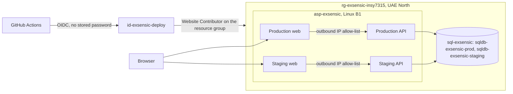

# Chapter 7: Hosting, CI/CD and operations

Owner: Josh (P4). This chapter covers where Exsensic runs, how a change reaches staging and production, how it is watched and rolled back, what it costs, and what changed in Task 3. It describes what is in the repository on `develop`; anything not yet done is marked as such.

Related: [operations.md](../operations.md) (the runbook), [migrations.md](../migrations.md), [security.md](../security.md), [CONTRACTS.md](../CONTRACTS.md) sections 9 and 12.

## 7.1 Azure topology

| Environment | Web (MVC) | API | Database |
|---|---|---|---|
| Staging | `app-exsensic-web-staging` | `app-exsensic-api-staging` | `sqldb-exsensic-staging` |
| Production | `app-exsensic-web` | `app-exsensic-api` | `sqldb-exsensic-prod` |

- **Service separation.** The MVC web app and the Web API are separate apps, so each is deployed, restarted and restricted on its own. The browser only talks to the web app; the web app calls the API.
- **Region.** UAE North, the closest region to South Africa that the Azure for Students subscription allows (South Africa North is blocked by its region policy).
- **Every app:** HTTPS only, minimum TLS 1.2, FTP and password publishing disabled, Always On, App Service health check on `/health`.
- **API protection.** Both API apps accept traffic only from the web apps' possible outbound IP addresses. The deployment site keeps its own rules so GitHub can still deploy. This replaces the virtual network and private endpoint of the Part 1 design, which need a more expensive tier (decision 12 in CONTRACTS.md).
- **Secrets.** Connection string, JWT signing key and seed passwords are App Service settings: encrypted at rest, never in Git, different per environment. The deploy identity has no stored password. Key Vault is the first upgrade if the system grows.

## 7.2 Tier, budget and cost rationale

One Basic (B1) plan hosts all four apps. Both databases use the Azure SQL free offer (serverless, auto-pause).

| Plan tier | Deployment slots | Autoscale | List price (UAE North, Linux) | Per day |
|---|---|---|---|---|
| B1 (now) | none | manual scale-out only | US$0.022 per hour | about US$0.53 |
| S1 | up to 5 | yes | US$0.125 per hour | about US$3.00 |
| P0v3 | up to 20 | yes | US$0.0955 per hour | about US$2.29 |

Prices are the Azure retail list prices read on 2026-10-29. At US$0.022 per hour, B1 is about US$16 a month for all four apps.

**Decision.** B1 stays the standing tier. The Task 2 marker suggested slots and autoscaling; both need Standard or above. A seven-day S1 window costs about US$21, which is more than the US$20 monthly budget alert, so it needs the team's and the subscription owner's agreement first. Instead of buying it, the release pipeline was built to support slots (7.4), and the switch-on and switch-back steps are documented in operations.md section 8. The limitation is stated honestly: on B1 a deploy briefly restarts the app.

**Azure rather than AWS.** Part 1 contained AWS costing research alongside Azure deployment material. Part 2 standardised on Azure for three reasons: the system is .NET end to end and App Service runs ASP.NET Core without containers to manage; GitHub Actions signs in to Azure with a managed identity instead of stored passwords; and the Azure SQL free offer keeps both databases at no cost. The AWS figures were research, not a built system, so this is a design decision, not a correction.

## 7.3 Continuous integration

Four workflows live in `.github/workflows/`.

| Workflow | Trigger | What it does |
|---|---|---|
| `pr-checks` | Pull request | Checks the branch name and commit messages against CONTRIBUTING.md |
| `ci` | Pull request, push | Restore, build in Release with warnings as errors, unit tests, integration tests against a SQL Server container, vulnerable-package check, secret scan (gitleaks) |
| `cd-staging` | Merge to `develop` | Build and test, publish, deploy API then web, smoke test, Playwright end-to-end tests |
| `cd-production` | Merge to `main` | Same tests and publish, then a manual approval gate, then deploy and smoke test |

Controls around the pipeline:

- **Branch protection** is on for `develop` and `main`: a pull request and passing `build-test` and `pr-checks` are required; force pushes and deletion are blocked. Required approvals are not set, because the one person who merges would block themselves. CODEOWNERS routes review to the owner of each area.
- **Merge commits only**, so the history shows each feature branch.
- **Dependabot** raises weekly update pull requests for NuGet and GitHub Actions; they go through the same checks.
- **The build treats warnings as errors**, including NuGet vulnerability warnings, so a vulnerable dependency stops the pipeline instead of reaching a release.

## 7.4 Release and approval

1. Feature branches are merged into `develop` through reviewed pull requests; each merge deploys to staging.
2. For a release, Josh opens `release/vX.Y.Z` into `main`.
3. `cd-production` runs the tests and publishes, then **opens a GitHub issue and pauses**. A team member in `PRODUCTION_APPROVERS` who is not the person who started it comments `approve`. `deny`, or no answer within 60 minutes, stops the run.
4. The workflow signs in to Azure with OpenID Connect, temporarily adds the runner's IP to the API's access restriction, deploys, smoke tests `/health`, `/health/ready` and `/`, and always removes the temporary rule.
5. **Slot-based release (optional).** If the repository variable `PRODUCTION_SLOT_NAME` is set, each app is deployed to that slot, tested there and swapped into production; if production fails its checks after the swap, the previous web version is swapped back. With the variable empty, the workflow deploys directly as before.

The issue-based approval gives the same "a second person approves" control as GitHub's environment reviewers, which need a paid plan on a private repository.

## 7.5 Health, monitoring and backups

- **Health endpoints** on every app, anonymous and outside `/api/v1`: `/health` (the process is up) and `/health/ready` (the API can reach its database). App Service uses `/health` for its health check, and the smoke test in each deployment checks both.
- **Application Insights** is wired into both apps and switches on when App Service monitoring is enabled; the connection string is supplied by App Service. Every API error carries a `traceId` to search for. Logs never contain passwords, tokens, emails or requirement text.
- **Backups.** Azure SQL keeps point-in-time backups for 7 days. A database can be restored to a moment before a bad release (portal, the database, Restore), which creates a copy to point the API at.

## 7.6 Rollback

| Fastest first | When to use it |
|---|---|
| Re-run the last good `cd-production` or `cd-staging` run (Re-run all jobs); it deploys that run's original commit, and artifacts are kept for 14 days | The latest deployment is bad |
| Revert the merge on `develop` in a pull request and release again | The bad commit must not be redeployed later |
| Swap the slots back (slot releases only) | A slot release passed its checks but misbehaves |
| Fix forward with a new migration, or restore the 7-day backup | The database changed; migrations never move backwards |

**If a production deployment fails:** the run goes red at the failing step and the temporary access rule is always removed. On a direct deploy the new version is already live when the smoke test fails, so re-run the last green production run or revert the merge (table above). On a slot release a failing slot test stops the run before the swap, so production keeps serving the old version. Check `/health/ready` on both apps afterwards.

## 7.7 Task 3 changes

Each entry has four parts: the earlier feedback, the change made, how it was verified, and what it means for Exsensic's users.

| # | Earlier feedback | Change made | Verification | Client impact |
|---|---|---|---|---|
| 1 | Hosting stability 14/15: "slots/autoscaling suggested" | Costed tier decision (7.2); `cd-production` made slot-aware behind `PRODUCTION_SLOT_NAME` (PR #51); switch-on and switch-back steps in operations.md section 8 | Release run with the variable empty deploys as before; slot run is documented, not performed (see the status table below) | A release can be swapped in without restarting the live app, once the team approves the extra cost |
| 2 | CI/CD 19/20 | Fixed a failing restore caused by a vulnerable transitive package: `System.Security.Cryptography.Pkcs` pinned to 10.0.13 (PR #49); Dependabot backlog merged and duplicate pull requests closed | `ci` green on `develop`; `cd-staging` green after the merge | Vulnerable dependencies stop the pipeline before they reach users |
| 3 | Git workflow 10/15: "uneven commit balance and compressed timeline" | Branch protection on `develop` and `main`; CODEOWNERS (PR #64); migration policy (PR #50, migrations.md) | Branch protection read back from the GitHub API on 2026-10-29: required checks `build-test` and `pr-checks`, force pushes and deletion blocked | Every change is reviewable and traceable to a pull request |
| 4 | Safe releases (Task 3 audit) | Production pre-migration data check added to the release steps (PR #65) | `docs/task3/pre-migration-checks.sql` run against production before the release (record the date and both PASS results here) | A migration cannot take production down because of existing data |

| Item | Status |
|---|---|
| Slot-aware production pipeline | Completed (code merged); first production run happens with the release |
| Slot and autoscale demonstration on S1 | **Evaluated option, not implemented** (cost above the monthly budget alert; needs the team's and the subscription owner's agreement) |
| Branch protection, Pkcs pin, migration policy, pre-check step | Completed |
| Required approvals on pull requests | Deferred: the single merger would block themselves |

## 7.8 Limitations

- One small B1 machine is shared by four apps, so it is slower under load, and a deploy restarts the app (no slots on B1).
- The free-offer database pauses when idle; the first request after a quiet period can take up to about a minute. Open the site a minute or two before a demo.
- The web apps' outbound IPs are shared with other Azure customers on the same scale unit, so the API allow-list keeps it off the open internet but is not a private network.
- End-to-end tests create real bookings on staging.
- Not yet done: the first production run of the slot-aware pipeline happens with the release that carries it; the slot demonstration itself is a documented option, not a standing feature.

## 7.9 Evidence to attach

Redact the subscription ID, tenant ID and any email address first.

| # | Evidence | Where from |
|---|---|---|
| 1 | Plan tier and resource list | Azure portal, `asp-exsensic` Overview, and the resource group |
| 2 | Health output for each app | `/health` and `/health/ready` |
| 3 | Backup and retention setting | Portal, `sqldb-exsensic-prod`, Backups |
| 4 | API access restrictions | Portal, API app, Networking |
| 5 | Green PR checks | A pull request's Checks tab |
| 6 | Staging run with smoke test and Playwright | Actions, `cd-staging` run (note run ID and commit) |
| 7 | Production run with approval | Actions, `cd-production` run and the approval issue |
| 8 | Rollback rehearsal | Re-run of a previous green `cd-staging` run |
| 9 | One browser booking | Staging or production site |
